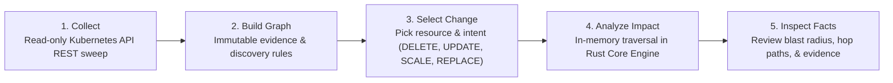

<p align="center">
  
</p>

# WhatBreaks (WB)
[](https://whatbreaks.dev)
[](https://whatbreaks.dev)
[](https://github.com/aaradhychinche-alt/WhatBreaks)
[](LICENSE)

> **"Know what could break before you change your infrastructure."**

WhatBreaks is a deterministic change-impact analysis and topology exploration engine for infrastructure. It identifies what other services, workloads, and routes could be impacted before an operator deletes, updates, scales, or replaces a resource.

- **Website**: [https://www.whatbreaks.dev/](https://www.whatbreaks.dev/)
- **GitHub Repository**: [https://github.com/WhatBreaks/WhatBreaks](https://github.com/WhatBreaks/WhatBreaks)
- **License**: [MIT](LICENSE)
- **Status**: **WhatBreaks V1 is free to use for Kubernetes.**

---

## 1. Project Introduction

### The Problem
In modern cloud-native environments, infrastructure components are deeply intertwined through label selectors, ingress rules, service endpoints, environment variables, config mounts, and volume claims. Because these relationships are often opaque and distributed across disparate YAML files, modifying or decommissioning a resource—like deleting a ServiceAccount, resizing a deployment, or updating a ConfigMap—frequently causes unexpected cascading outages across upstream and downstream systems.

### Who It Is For
WhatBreaks is built specifically for:
- **Site Reliability Engineers (SREs)** planning safe production maintenance and evaluating blast radius.
- **Platform Engineers** auditing cluster topology and mapping dependencies across teams and namespaces.
- **DevOps Engineers** seeking pre-flight validation before committing Terraform, Helm, or Kubernetes manifests.
- **Kubernetes Users & Operators** needing an immediate, explainable answer to: *"If I touch this resource, what else breaks?"*

### Blast-Radius Exploration
Unlike monitoring tools that alert you **after** an outage occurs, WhatBreaks operates **before** changes happen. It maintains an in-memory graph of your infrastructure, traverses directed dependency paths, applies change-aware propagation rules, and returns an explainable answer backed by factual provenance evidence.

---

## 2. How It Works

WhatBreaks operates through a deterministic 5-step pipeline:



1. **Collect Infrastructure Resource Information**:
   The Go collector executes a strictly read-only sweep of your Kubernetes cluster (Pods, Deployments, Services, Ingresses, ConfigMaps, Secrets metadata, etc.).
2. **Build and Maintain a Dependency Graph**:
   Observations are normalized into immutable point-in-time `Evidence` records. The Rust Core Engine applies deterministic discovery rules (`Ownership`, `Resource Reference`, `Runtime Connection`) to synthesize semantic directed edges, which are durably stored in PostgreSQL and materialized into an in-memory graph.
3. **Select a Resource and Proposed Change**:
   In the UI or via API, an engineer selects a target resource and specifies a change operation: `DELETE`, `UPDATE`, `SCALE`, or `REPLACE`.
4. **Analyze Potential Impact**:
   The Rust Core Engine traverses the graph according to deterministic propagation semantics, enforcing hop depth limits and directional constraints (`incoming` callers vs `outgoing` dependencies).
5. **Inspect Affected Resources, Paths, Evidence, & Limitations**:
   The operator inspects candidate impacted resources, shortest hop distances, directed dependency paths, supporting evidence IDs, assumptions, limitations, and analysis completeness facts.

---

## 3. Features

### Verified Implemented Capabilities (V1)
- **Kubernetes Resource Inventory**: Discovers and indexes 13 core Kubernetes resource types across cluster and namespace scopes.
- **Interactive Dependency Graph Visualization**: Visualizes directed relationships (`OWNS`, `SELECTS`, `ROUTES_TO`, `MOUNTS`, `CONNECTS_TO`) with pan, zoom, and node filtering.
- **Change-Aware Impact Analysis**: Simulates the blast radius of 4 change operations (`DELETE`, `UPDATE`, `SCALE`, `REPLACE`) with configurable traversal directions (`incoming` vs `outgoing`) and bounded hop depth.
- **Factual Evidence & Provenance**: Every discovered relationship is linked to immutable, timestamped observation evidence proving why the connection exists.
- **Multi-Cluster Support**: Uses canonical cluster-prefixed identities (`<cluster_id>/<namespace>/<name>`) to prevent cross-cluster collisions and allows filtering topology by cluster.
- **Workspace Isolation & Integrity Safeguards**: Partitions state by tenant workspace UUID and rejects un-migrated or ambiguous legacy state (`IDENTITY_INTEGRITY_REJECTED`) to guarantee analysis correctness.
- **Automated Diagnostics & Guided Recovery**: Built-in automated diagnostic probes test component reachability, RBAC permissions, and context alignment, providing one-click guided recovery.
- **Zero Secret Custody**: Strictly strips all Secret payload values (`.data`, `.stringData`, private keys) at the unmarshaling layer, preserving only metadata and key names.

### What WhatBreaks is NOT
- **Not an Automated Remediation Tool**: WhatBreaks does not automatically apply fixes, patch clusters, or mutate resources.
- **Not a Chaos Engineering Tool**: WhatBreaks does not inject faults, kill pods, or induce network latency in your cluster. It is a pre-flight analytical exploration platform.

---

## 4. Screenshots & Demo

### Topology & Impact Architecture Diagram


### System Health & Telemetry Architecture Diagram


## 5. Quick Start

### Prerequisites
Before running WhatBreaks, verify you have the following installed:
- **Go**: `1.22+` (`go version`)
- **Rust & Cargo**: `1.75+` (`cargo --version`)
- **Node.j & npm**: `Node 18+` (`node -v && npm -v`)
- **Docker & Compose**: Docker Desktop 4.25+ (`docker compose version`)
- **kubectl**: `v1.28+` (`kubectl version --client`)
- **netcat (`nc`)**: Preinstalled on macOS / Linux

### Clone & Start the Full Stack
WhatBreaks provides an idempotent stack runner at [`scripts/wb.sh`](scripts/wb.sh):

```bash
# 1. Clone repository
git clone https://github.com/WhatBreaks/WhatBreaks.git
cd WhatBreaks

# 2. Launch the full development stack
./scripts/wb.sh start
```

### What `scripts/wb.sh start` Does:
- Verifies system prerequisites (`go`, `cargo`, `node`, `npm`, `docker`, `kubectl`, `nc`).
- Ensures Docker daemon is responsive (auto-launches Docker Desktop on macOS if stopped).
- Starts PostgreSQL 16 on port `5432` via `docker compose up -d postgres` (using persistent volume `whatbreaks_postgres_data`).
- Builds and starts the Rust Core Engine on port `50051`.
- Inspects your active `kubectl` context and starts an authenticated `kubectl proxy --port=8001`.
- Builds and starts the Go Platform API on ports `8080` (API) and `8081` (Health Probes).
- Starts the Vite React dashboard on port `3000`.
- Executes an initial discovery synchronization sweep and verifies resource counts.

### Open the Dashboard
Open your browser to:
```text
http://localhost:3000
```

### Verifying Service Health
Check process status, port bindings, and ownership:
```bash
./scripts/wb.sh status
```

Run complete connectivity diagnostics:
```bash
./scripts/wb.sh doctor
```

### Stopping Services Cleanly
```bash
./scripts/wb.sh stop
```
`wb.sh stop` terminates **only** the processes started by the script (tracked in `.run/*.pid`). It leaves pre-existing external processes intact and preserves your PostgreSQL database volume.

---

## 6. Kubernetes Setup & Connectivity

### Connection Model
WhatBreaks communicates with Kubernetes via a **pure HTTP REST client**. It does **not** parse or use your `KUBECONFIG` file for API authentication.

- **Local Development**: Runs `kubectl proxy --port=8001` locally. The collector connects to `http://127.0.0.1:8001`.
- **In-Cluster Execution**: Connects to `https://kubernetes.default.svc` using the pod's ServiceAccount token.
- **Direct Remote Endpoint**: Connects to an API URL specified via `--k8s-api-url`.

### Read-Only Permissions
WhatBreaks requires only `get` and `list` permissions. Apply the read-only RBAC policy:

```yaml
apiVersion: rbac.authorization.k8s.io/v1
kind: ClusterRole
metadata:
  name: whatbreaks-viewer
rules:
  - apiGroups: [""]
    resources: ["namespaces", "pods", "services", "configmaps", "serviceaccounts", "persistentvolumes", "persistentvolumeclaims", "nodes", "secrets"]
    verbs: ["get", "list"]
  - apiGroups: ["apps"]
    resources: ["deployments", "replicasets", "statefulsets", "daemonsets"]
    verbs: ["get", "list"]
  - apiGroups: ["networking.k8s.io"]
    resources: ["ingresses"]
    verbs: ["get", "list"]
  - apiGroups: ["discovery.k8s.io"]
    resources: ["endpointslices"]
    verbs: ["get", "list"]
```

> [!NOTE]
> **Zero Secret Custody**: While `secrets` is listed above to discover that a workload references a secret, **WhatBreaks never reads or stores secret values**. The REST client unmarshals only `.metadata` and map keys, discarding all payloads and private keys during stream decoding.

For full RBAC manifests and namespace filtering options, see [Kubernetes Setup Guide](docs/kubernetes-setup.md).

---

## 7. Example Workflow

Here is a practical walkthrough of investigating a proposed infrastructure change:

1. **Start WhatBreaks**: Launch the stack with `./scripts/wb.sh start` and navigate to `http://localhost:3000`.
2. **Open Investigate Page**: On the left sidebar, choose a target resource (e.g. `k3d-license-service/default/order-service`).
3. **Configure Proposed Change**:
   - **Operation**: Select `DELETE`.
   - **Direction**: Choose `Incoming (Dependents / Callers)` to discover what components rely on this service.
   - **Max Depth**: Set to `3`.
4. **Click "Analyze DELETE Impact"**: The Core Engine evaluates the graph and returns:
   - **Summary**: `Total Impacted: 2, Direct: 1, Indirect: 1, Max Depth: 2`.
   - **Impacted Resources**:
     - Direct: `order-ingress` (Ingress routing target will be deleted).
     - Indirect: `gateway-service` (Routes to the affected ingress).
   - **Paths**: Displays the exact dependency chain: `order-service` $\leftarrow$ `order-ingress` $\leftarrow$ `gateway-service`.
   - **Evidence**: Displays supporting observation IDs and discovery timestamps.
   - **Assumptions**: Transparently notes that callers are assumed to require synchronous service reachability.
5. **Interpret the Findings**:
   WhatBreaks identifies **potential** effects, not guaranteed outages. While `order-ingress` will fail to route traffic, upstream callers with circuit breakers or retry policies may absorb transient failures.

---

## 8. Configuration Reference

### Port Allocations
| Port | Component | Protocol | Default Binding | Purpose |
| :--- | :--- | :--- | :--- | :--- |
| **`3000`** | Frontend Dashboard | HTTP | `0.0.0.0:3000` | Web user interface |
| **`5432`** | PostgreSQL 16 Store | TCP | `127.0.0.1:5432` | Source of truth for graph state |
| **`8001`** | Kubernetes Proxy | HTTP | `127.0.0.1:8001` | Local authenticated `kubectl proxy` |
| **`8080`** | Go Platform API | HTTP | `0.0.0.0:8080` | REST API and discovery coordinator |
| **`8081`** | Go Health Server | HTTP | `0.0.0.0:8081` | Kubernetes `/readyz` and `/healthz` probes |
| **`50051`**| Rust Core Engine | gRPC | `127.0.0.1:50051` | In-memory graph engine |

### Key CLI Flags & Environment Variables (`cmd/wb`)
| Flag | Environment Variable | Default Value | Required | Purpose |
| :--- | :--- | :--- | :--- | :--- |
| `--api-port` | `WB_API_PORT` | `8080` | No | HTTP REST API port |
| `--health-port`| `WB_HEALTH_PORT` | `8081` | No | Health probe port (`/readyz`, `/healthz`) |
| `--core-engine-addr`| `WB_CORE_ADDR` | `127.0.0.1:50051` | No | Rust Core Engine gRPC endpoint |
| `--workspace-id`| `WORKSPACE_ID` | `00000000-0000-0000-0000-000000000001` | No | Workspace UUID scoping tenant data |
| `--enable-k8s` | `K8S_ENABLE` | `true` | No | Enables the Kubernetes collector |
| `--k8s-api-url`| `K8S_API_URL` | `""` (or `http://127.0.0.1:8001`) | Conditional | Kubernetes API server URL |
| `--k8s-cluster-id`| `K8S_CLUSTER_ID` | Auto-detected | No | Cluster name prefixing resource identities |
| `--k8s-namespaces`| `K8S_NAMESPACES` | `""` (all namespaces) | No | Comma-delimited namespace filter |
| `--k8s-cluster-wide`| `K8S_CLUSTER_WIDE`| `false` | No | Observes nodes, namespaces, and PVs |
| — | `TEST_DB_PASSWORD` | `testsecret` | No | Development PostgreSQL password |

> [!WARNING]
> **Forbidden Variables**: WhatBreaks strictly terminates with an error if raw tokens (`WB_API_TOKEN`, `TT_API_TOKEN`) or `KUBECONFIG` are passed in environment variables. Mount tokens as files via `WB_API_TOKEN_FILE` with `0600` permissions.

For the exhaustive reference table, see [Configuration Reference](docs/configuration.md).

---

## 9. Troubleshooting

| Issue / Symptom | Likely Cause | Diagnostic Command | Quick Fix |
| :--- | :--- | :--- | :--- |
| **Docker daemon not running** | Docker Desktop stopped. | `docker info` | Start Docker Desktop (`open -a Docker`). |
| **PostgreSQL connection failed** | Container stopped or port conflict. | `nc -z 127.0.0.1 5432` | `docker compose up -d postgres` |
| **Core Engine unavailable (50051)** | Process terminated or unbuilt. | `nc -z 127.0.0.1 50051` | `cargo build -p wb-core-server && ./target/debug/wb-core-server &` |
| **Collector proxy unreachable (8001)** | `kubectl proxy` not running. | `curl -s http://127.0.0.1:8001/readyz` | `kubectl proxy --port=8001 &` |
| **Empty resource inventory (0)** | Sync not run or namespace empty. | Check `GET /api/v1/system/health` | Trigger sync via UI or `POST /api/v1/discovery/sync`. |
| **No relationships found (isolated nodes)** | Workloads lack matching selectors. | Inspect PostgreSQL `state_relationships` | Expose Deployment with a matching Service selector. |
| **`IDENTITY_INTEGRITY_REJECTED`** | Legacy un-prefixed IDs in DB. | Check `GET /api/v1/system/diagnose` | Run recovery action `sync_discovery` with confirmed=true. |
| **Port conflict on startup** | Orphaned process holding port. | `lsof -iTCP:<port> -sTCP:LISTEN` | Run `./scripts/wb.sh stop` or `kill -TERM <PID>`. |

For in-depth root-cause analysis and remediation steps, see [Troubleshooting Guide](docs/troubleshooting.md).

---

## 10. Security & Safety

- **Read-Only Collection**: Zero mutating Kubernetes verbs are implemented in the client.
- **Zero Secret Custody**: Secrets metadata is collected to establish references, but payload values, passwords, and private keys are never read, stored, or transmitted.
- **Credential Hygiene**: Prohibits raw tokens and kubeconfigs in environment variables.
- **Tenant Isolation**: Every database record is partitioned by `workspace_id`.
- **Identity Disambiguation**: Canonical resource identities prevent cross-cluster spoofing.
- **API Security Middleware**: Enforces double-submit CSRF cookie validation, rate limiting, 10MB payload limit, CORS restrictions, and security headers.

For the complete threat model and security boundaries, see [Security Model](docs/security.md) and our [Security Policy](SECURITY.md) for responsible vulnerability disclosure.

---

## 11. Development & Testing

### Running Tests
WhatBreaks includes verification suites across Go, Rust, and TypeScript:

```bash
# 1. Run the full unified test suite
./scripts/test.sh

# 2. Run Go unit & integration tests
go test -count=1 ./...

# 3. Run Go concurrency race detector
go test -race -count=1 ./internal/api ./internal/answer ./internal/state

# 4. Run Rust workspace tests
cargo test --workspace

# 5. Run frontend lint and build
cd web && npm run lint && npm run build
```

### Optional Kubernetes Acceptance Tests
To run integration tests against a real cluster safely:
```bash
# Strictly requires a dedicated test cluster named 'whatbreaks-e2e'
k3d cluster create whatbreaks-e2e --wait
./scripts/test.sh --with-k8s
k3d cluster delete whatbreaks-e2e
```

For developer environment setup, protobuf regeneration, and code standards, see [Developer Guide](docs/development.md).

---

## 12. Roadmap & Contribution

### Future Direction
- Additional cloud infrastructure providers (AWS VPC/IAM, GCP Cloud SQL).
- Real-time Kubernetes event streaming (Watch API integration).
- Multi-collector concurrent ingestion.
- CI/CD pre-merge pull request impact analysis bot.

### Contributing
Contributions, bug reports, and pull requests are welcome. Please read our [Contribution Guide](CONTRIBUTING.md) and [Code of Conduct](CODE_OF_CONDUCT.md) before submitting changes:
1. Review the [Contribution Guide](CONTRIBUTING.md) and [Developer Guide](docs/development.md).
2. Create a feature branch from `main`.
3. Verify all tests pass with `./scripts/test.sh`.
4. Open a GitHub Pull Request with a clear explanation of changes.

### License
WhatBreaks is open-source software licensed under the [MIT License](LICENSE). Copyright &copy; 2026 Aaradhy Chinche. See the [LICENSE](LICENSE) file for the full license text.

---

## 13. Documentation Index

Detailed documentation is available in the [`docs/`](docs/) directory:

- [System Architecture & Data Flow](docs/architecture.md)
- [Installation & Quick Start](docs/installation.md)
- [Kubernetes Setup & RBAC](docs/kubernetes-setup.md)
- [Configuration Reference](docs/configuration.md)
- [User Guide & Workflows](docs/usage.md)
- [Troubleshooting & Diagnostics](docs/troubleshooting.md)
- [Security & Safety Model](docs/security.md)
- [Developer & Testing Guide](docs/development.md)
- [REST & Probe API Specification](docs/api.md)
- [Contribution Guidelines](CONTRIBUTING.md)
- [Code of Conduct](CODE_OF_CONDUCT.md)
- [Security Policy](SECURITY.md)
